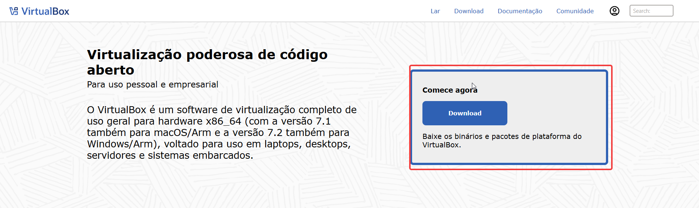
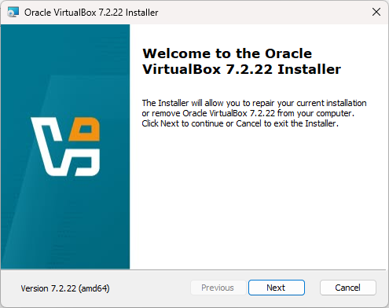
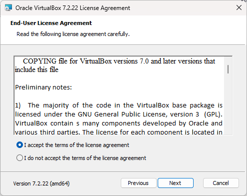
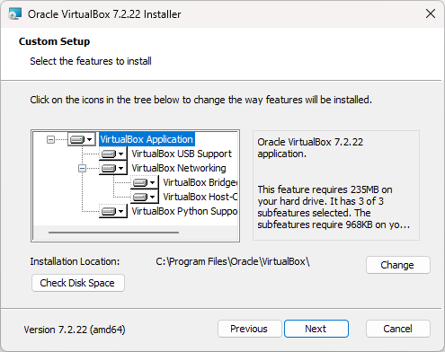
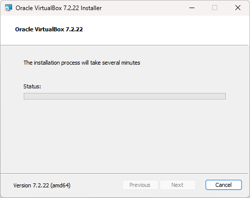
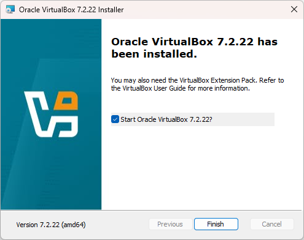
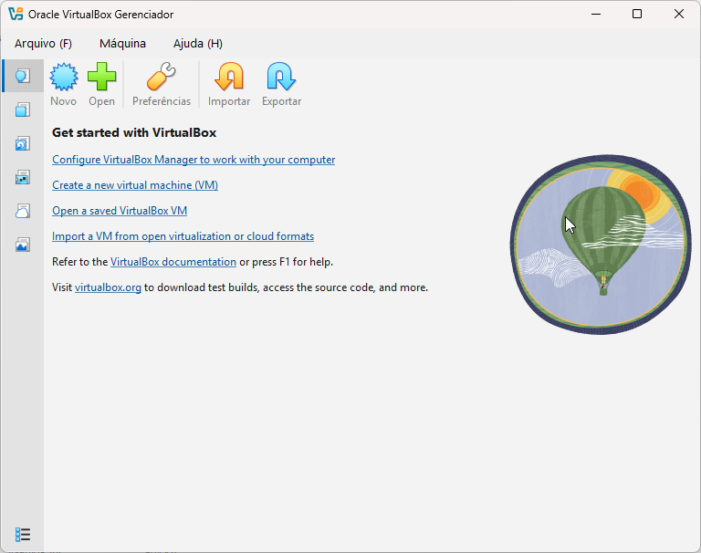

# Laboratório de Virtualbox

## Objetivo
Utilizar o Oracle VM VirtualBox como ambiente de virtualização para criar e configurar máquinas virtuais destinadas  aos estudos práticos em ciberssegurança.

O Objetivo é desenvolver conhecimentos em sistemas operacionais, redes de computadores, administração de ambientes virtuais e segurança da informação, criando um laboratório isolado para realizar testes e simulações de forma segura

## Instalação do VirtualBox
A máquina virtual permite criar um ambiente computacional isolado dentro do computador físico, possibilitando instalar e executar diferentes sistemas operacionais sem alterar o sistema principal.
Neste laboratório, a máquina virtual será utilizada para realizar estudos práticos, testar configurações e explorar ferramentas de Segurança da Informação em um ambiente controlado.
Para começar, será necessário instalar o Oracle VirtualBox, uma ferramenta de virtualização que permite criar e gerenciar máquinas virtuais.
Acesse o link oficial para realizar o download:

[Download do Oracle VirtualBox](https://www.virtualbox.org/wiki/Downloads)

A seguir, apresento um passo a passo simples de como realizar a instalação e preparar o ambiente para os próximos laboratórios.

  
   
  <strong>Passo 1 – Tela inicial para o download da VM</strong>

  
   
  <strong>Passo 2 – Tela inicial para a instalação</strong>

  
   
  <strong>Passo 3 – Tela para aprovar a instalação</strong>

  
   
  <strong>Passo 4 – Tela da localização do caminho onde sera instalado o software</strong>

  
   
  <strong>Passo 5 – Tela inicial para a instalação</strong>

  
   
  <strong>Passo 6 – Finalizando a instalação do Orancle Virtualbox </strong>

  
   
  <strong>Passo 7 – Tela principal do VM, sem nenhuma máquina instalado </strong>

